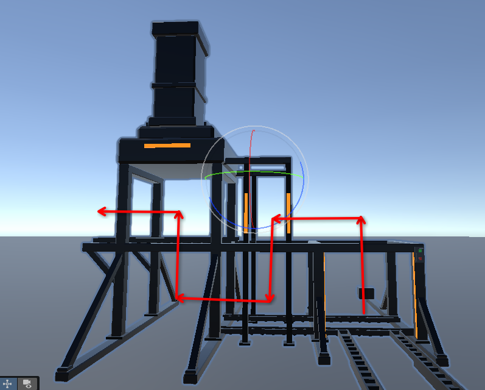

# Loading

How consumables in whole units get into a component: fuel rods into the reactor first, ammunition later.
**In discussion (2026-10-08); hand-feeding the reactor is built, untested.** The item port, `LoadingModule`,
the reactor's refuelling, `LoadableItem`, the fuel rod, and the port drawing a let-go rod in.

## Built (2026-10-08, untested)

- **The item port:** `FlowDirection.Item`, set on a component's port like In, Out or Data (the port inspector
  has **Add Item**). It carries no power and no data. It shows as `Prefabs/Components/Item Port` in place of
  the round Port prefab: its opening (socket and two closed doors) is the whole cell face, 0.5 m, so a fuel rod
  (0.48 m across) goes in without clipping; an amber border (`ComponentItem.mat`) of 3 cm bars sits outside the
  cell (0.56 m overall, so it reaches 3 cm into neighbouring cells), on a 0.56 m container that sinks 0.29 m
  into the component to fill the gap to a model set in from its cell face. Set in
  `ComponentEdgeModule`'s **Item Port Prefab** (set on every component prefab). Gizmo and slot preview show
  it too. `ComponentEdgeModule.ItemAt(face, cell)` says where one is.
- **Its intake and doors** (`ItemPort`, on the Item Port prefab; every client runs it): a trigger box in front of
  the face, one cell (0.5 m) each way, looked inside every 0.1 s. The doors open (each half hangs from its outer
  edge and narrows into the frame, 0.5 s) while a `LoadableItem` that one of the component's `LoadingModule`s
  would take now (of the type it accepts, holding none) is inside, held or not, and close when there is none. Each client
  works this out from where it sees the item, so nothing is sent for the doors.
- **Door sounds** (`Vehicle_Essentials`, `assets.md`): `Vehicle_Car_Trunk_Open_Button` as the doors start to
  open, `Vehicle_Car_Trunk_Close_Impact` as they land shut (not if they reopen first), from the prefab's **Doors Sound** child (Environment layer, heard
  to 15 m). Each
  client plays them from its own doors, so nothing is sent.
- **Drawing an item in:** when a hand **on this client** lets go of such an item in the intake, this client
  (which held it, so has its authority through `NetworkGrabbable` and moves it for everyone through its
  `NetworkRigidbody3D`) turns off its grab and colliders, makes it kinematic, lines it up with the port over
  **Align Seconds** (0.75), draws it in end first over **Draw In Seconds** (5), loads it
  (`LoadingModule.LoadByHand`), waits for the doors to shut, and removes it (`Item.Remove`, set by
  `ShipNetwork` to `ItemNetwork.Remove`: despawn, taking authority first if needed, as for an addon
  item; destroyed locally with no network).
- **The load reaches the master:** `LoadByHand` loads here at once and raises `LoadedByHand`; on a non-master
  `ComponentNetwork` sends **ItemLoaded** (message 6: which of the component's `LoadingModule`s, by its place
  in `GetComponents`, the same on every client) and the master loads it too and writes
  it out with the rest, as the reactor's dial does.
- **Items are types, not a list of kinds** (decided 2026-10-08: a kind dropdown would grow without end).
  `LoadableItem` (`scripts/Ship`) is an empty abstract base; each kind of item is a subclass, so far
  `LoadableFuelRodItem`. A new item is a new subclass and touches nothing else.
- **`Item`** (`scripts/Ship`) is the base of everything carried: `AddonItem` and `LoadableItem` both derive from
  it. It holds the grab and the body, and lets an item that appeared out of physics fall once a hand first lets
  go of it. `ItemDispenser` puts out any `Item`, so a dispenser with the Fuel Rod in its **Item** slot spawns
  fuel rods (once the Fuel Rod is on `SceneNetworking`). Custom behaviour (a dropped
  rod making a radioactive zone) comes with health and environment.
- **`LoadingModule`** (`scripts/Ship/Modules`): its **Accepts** slot takes an item prefab (the reactor's holds
  Fuel Rod), and it takes every item of that prefab's type (`Accepts(item)`; a behaviour finds its module with
  `Takes<LoadableFuelRodItem>()`). It holds one or none: `Load()` takes one in when it is empty, `Consume()`
  gives it up.
  Its one networked value (holds one or not) goes through `ComponentNetwork` like any `INetworkedState`.
  **Starts With One** and the context menu's **Load One** stand in for loading until items exist. The Reactor
  prefab has one, for fuel rods.
- **The reactor refuels from it.** `FissionCore` has **Fuel Seconds Per Rod** (the reactor's Inspector field,
  formerly Fuel Seconds; 500 on the prefab) and `FuelLevel`, 100% to 0%. Spent, it calls its `Refuel`, which
  the reactor module answers by consuming from its fuel-rod `LoadingModule`; if that held one, the core is
  full again at once. It starts with one rod in. The reactor's readout shows its own `fuel 87%`; the `LoadingModule` has its own
  **Readout** field, showing `FuelRod: next in / none`. Every client
  runs this in its sim and the master's state (fuel, held or not) corrects it, as for the rest of the reactor.
  Sim test: `SpentRodTakesTheNextOne`.
- **The fuel rod** (`Prefabs/Items/Fuel Rod`): grabbed and networked as the Switch Addon is (`Rigidbody`,
  `XRGrabInteractable`, `IgnoresPlayerBody`, `NetworkObject` with flags 524289, `NetworkRigidbody3D`,
  `NetworkGrabbable`) plus `LoadableFuelRodItem`. **Needs adding to `SceneNetworking`'s network prefabs to be
  spawned.** Its model: 1 × 2 × 1 cells,
  long axis Y, root at its centre. A hexagonal body 0.48 m across the corners with 0.6 m straight sides and a
  0.2 m metal pyramid at each end. Each side is a frame of 3 cm metal bars round a glass panel sunk 1 cm,
  glowing Cherenkov blue (`FuelRodMetal.mat`, `FuelRodGlass.mat`, URP Lit). One box collider on the root.
  Modelled in Blender: `Blender/FuelRod.blend` (outside Assets, never uploaded), exported to
  `Meshes/FuelRod.fbx`. After editing the .blend, export the FBX over that file with Forward -Z, Up Y and
  Apply Transform on; keep the material names, and Unity maps them to the URP materials.

- **The fuel pack** (`Prefabs/Items/Packs/Fuel Rod Pack`; written 2026-10-08, Play-mode checked offline for the
  lid, pictures and lamps only; grabbing and networking untested). `ItemPack : Item` (`scripts/Ship`) is the
  abstract base, `FuelRodItemPack` the fuel one; its **Contains** slot holds the Fuel Rod prefab. It keeps which
  of its 4 **Places** are filled (one bit each) and shows a local, never-spawned **picture** of the item in each
  (`LoadableItem.Picture`; ports ignore pictures). The **lid** is an `XRGrabInteractable` with a
  `SlideGrabTransformer` (6 cm up, 6 cm down, the slot handle bar's settings): a tug past 80% of that starts the
  **Lid Track** rising 1.08 m over 2 s, a push down on the open lid starts it sinking, and either lets go of the
  lid. Pictures show while the lid is off the box and can be grabbed once it is all the way up. Grabbing one
  empties its place and, next frame, swaps it for a spawned rod in the same hand (as an addon is taken from a
  hologram); a rod let go within 0.25 m of an empty place in the open pack is hidden, removed
  (`Item.Remove`) and fills the place (`LoadableItem.LetGo`). The 4 lamps show the count with
  `FuelPackGlow` lit, `FuelPackDark` unlit. Its own colliders ignore each other. **Sounds:** `Vehicle_Car_Trunk_Open` as the lid
  starts to rise, `Vehicle_Car_Trunk_Close` as it starts to sink, from the **Lid Sound** child of the Lid Track
  (Environment layer, heard to 15 m); each client plays them from its own lid, so nothing is sent. Mass 20 kg (provisional).
  **Networking:** `ItemPackNetwork` with a `NetworkBridgeData2` (filled + 1, lid 1 shut / 2 open). The pack's
  authority writes; others read. A hand on another client changes the pack at once and takes the authority;
  until it comes, that client keeps its own state. It also strips each picture's `NetworkGrabbable`. **Needs
  adding to `SceneNetworking`'s network prefabs, and a dispenser,** before it can be spawned in-world. Its
  origin is at the bottom of the box. Model: `Blender/FuelPack.blend`, built by `Blender/FuelPack.py`
  (`blender -b --python Blender/FuelPack.py -- <blend> <fbx>`), exported to `Meshes/FuelPack.fbx`.

- **The S2 loader** (`Prefabs/Components/Loader S2`; written 2026-10-08, the queue stepped by hand in Play mode
  offline, untested in-world). A component like the others (slot S2, power **In** on the back face at cell
  (0, 1), `NetworkBridgeData16`), with `LoaderBehaviourModule` (`scripts/Ship/Modules/Behaviours`), a
  `LoadBehaviourModule` drawing **50 W** (`power.md` → the scale of every number). Unpowered, nothing moves
  and nothing is taken in.
  - **The path:** the **Path** children, in order, are where a pack's origin (the bottom of its box) goes:
    **Entry** (on the front runners), **Place**, **Place Lifted** (14 cm up, in the mechanism), **Lowered**,
    **Out** (along the runners to the left until clear of the volume). **Places** lists the points where a
    pack waits, front of the queue to the end; the last is the one under the mechanism. Each size only needs
    its own path and places.
  - **Conveying:** each pack heads for the furthest place it may have, the one ahead first, at 0.5 m/s, and
    never moves into another pack (each is a 1.10 × 1.15 × 1.10 m box). The pack at the last place leaves
    when it is empty or the eject switch is on; one already past it always finishes. At the end of the path
    the master puts it back into the world as a spawned pack holding what it held, and it drops.
  - **The intake** (the **Intake** child, a 1.3 × 1.6 × 1.2 m box over the front runners): a pack a hand on
    this client lets go of in it settles onto **Entry** over 0.6 s, then becomes a picture there and is
    removed (`Item.Remove`). **In it means any part of the pack in the box** (2026-10-10, Vulps found packs the
    rails came out for being ignored): the same test that sends the rails out, so if they come out, letting go takes
    it. A pack let go outside the box is watched for 3 s in case it falls or slides in; only the client whose hand
    let go watches it. It waits in the box, and goes in when there is room: powered, a place free, and
    **Entry** clear. With the eject switch on it is still taken, and runs straight through and out. **A loader takes any
    type of pack** (Vulps's design: emergent "woopsies", which is what the eject switch is for). **Packs** lists every
    pack type (Fuel Rod Pack, Addon Pack); a pack whose items nothing wants just rides the conveyor until ejected. A
    pack's Contents (the addon pack's addons) ride through with it and come back out intact.
  - **The front rails** (decided and built 2026-10-08, untested): the sign that it is ready to take a pack.
    While a pack it would take now (powered, room, a type in **Packs**; held or not, eject on or off) is in the
    intake, an inner set of rails slides 1.1 m forward out from under the front runners at 0.8 m/s, as far
    out of the rig as the left runway, and back in once there is none. Rails staying in means it will not
    take it. `Vehicle_Car_Button_02` loops while they slide (**Rails Sound** child). Each client works this
    out from the packs it sees, as the item port's doors do, so nothing is sent. The intake box now reaches
    the end of the extended rails (1.3 × 1.6 × 1.8 m). The **Front Rails** model is drawn retracted, tucked
    under the place below every runner.
  - **Riding the rails in** (Vulps, 2026-10-10, untested): the intake box is stretched in code along the rails to
    Rails Reach past the path's first point (plus half its depth), so a pack can be put down anywhere from the
    extended rails' end to just inside the frame. A pack let go there lines up on the rails where it lies (no
    further out than they are), then the rails retract at their own speed and, once they reach it, carry it in
    on their end to the path's first point, where it is taken in as before. That stretch is the path's first
    stretch but not a place: never counted as room.
  - **Sound:** `Vehicle_Car_Engine_Idle_Interior_Loop_03` loops while any pack is moving, from the **Running
    Sound** child (Environment layer, heard to 15 m). Each client plays it from the packs it sees moving, so
    nothing is sent.
  - **Pictures:** `ItemPackPicture` copies a pack prefab's meshes, shut, with its count lamps showing.
  - **The eject switch** is the rocker (`RockerSwitch.prefab` without its switch addon) on the mechanism's
    front, right of the amber strip. `RockerSwitch` now throws any `ISwitch`; `SwitchAddon` and the loader
    are both one.
  - **Networking:** `LoaderBehaviourModule` is an `INetworkedState`: the eject switch, then per entry (one per
    place, plus one leaving) its kind, filled places and how far along the path it is. Every client conveys;
    the master's state corrects it (a pack within 15 cm is left where this client has it). A non-master
    feeding a pack sends **PackFed** (message 7: kind, filled) and throwing the switch sends **EjectSwitch**
    (message 8); for 1 s after either, that client keeps its own state. Only the master puts a leaving pack
    out (`Decides`, `PutOut`, spawned through `ComponentNetwork`). **Needs adding to `SceneNetworking`'s
    network prefabs** like every component.
  - Nothing draws from the pack in the mechanism yet: how the loader feeds a component is step 2's second half.

## The addon pack (built 2026-10-10, untested in-world)

For carrying addons from the dispensers to the work (a dozen trips was a dozen too many). `Prefabs/Items/Packs/Addon
Pack` (`AddonPack`, an `ItemPack`), modelled by `Blender/AddonPack.py` → `Meshes/AddonPack.fbx`: the fuel pack's base
and lid, **red** where it is blue (`AddonPackGlow`), with **eight count lamps**. Under the lid hangs a tray: **eight
places in a lattice round a solid middle block** as tall as the addons, with a red ring round its top. Each place holds
any addon item (switch, junction, voltmeter) **at full size, upright, its front facing out** so it can be read; the
corners face out diagonally. It **starts empty**.

- **In:** an addon item let go near an empty place in the open pack goes in, and is removed.
- **Out:** a hand taking one is given a real, spawned item, its state included (a +3 junction stays +3).
- **Contents:** each place's addon (its position in **Kinds**, at most four) and a junction's count, four bits a place,
  in one int (`ItemPack.Contents`). A loader carries it (two values per pack in its state) and the networking shares
  it: `ItemPackNetwork` writes it as a third int, so the pack has a `NetworkBridgeData4`. A pack fed by hand sends it
  to the master in **PackFed** (now three ints).
- **Getting one:** the **AddonPack Dispenser**, beside the fuel pack's. Registered on `SceneNetworking`.

## Decided

- **One in use, one waiting: the standard for every loading behaviour** (decided 2026-10-09). Whatever an item
  port feeds holds one unit in use and one spare in its `LoadingModule`, as the reactor does now. Each of the
  S5 reactor's six chambers follows it, with its own port on the reactor's top face (`reactor.md` → Six
  chambers). Loaders feeding top-face ports need their own behaviour: not designed yet.
- **Units only.** Loading moves whole items: fuel rods, ammunition. **Coolant is out of scope:** it is a
  liquid, and stays the drum and pump in `CoolantLoop` (`reactor.md`) until liquids get their own design.
- **A pack is an item with a kind and a quantity**: a fuel rod pack holding N rods, an ammo crate holding N
  rounds. Feeding takes one unit and the quantity drops by one. Scavenged packs arrive with fewer units.
  **An empty pack stays** (changed 2026-10-08: a unit can go back in, so empty is not finished); it goes when
  thrown in the trash (a trash system comes later).
- **The fuel pack is a box you take rods out of by hand** (decided 2026-10-08). Futuristic and dramatic, not a
  chest: an angular box, 1.10 × 1.10 × 1.15 m, a blue glowing seam under the lid, and four blue count lamps on
  the front, one lit per rod inside. The rods (2 × 2) hang from clamps under the lid. **A short tug on the lid
  starts it**: it rises straight up on its own, staying horizontal, about 1.05 m, lifting the rods clear of the
  box (about 2.2 m tall open); a short push down starts it sinking shut. Nothing holds the lid up: it is a
  game, not a reality simulator. Grab a rod to pull it from its clamp; let a rod go under an empty clamp and
  it goes back in. **A pack never goes into an item port**: a hand
  feeds the port one rod at a time, as now, and only the loader (step 2) takes whole packs.
- **The rods in a pack are not networked.** The pack keeps a count and shows one model rod per unit while
  open. Grabbing one spawns a real, networked rod into that hand and the count drops by one; a rod put back
  is despawned and the count goes up. The lid is the pack's own (stock XRI: an `XRGrabInteractable` that moves only
  up and down), and others see it move.
- **A `LoadingModule` defines what the component's item port accepts** (one kind per module; the reactor has
  one, for fuel) **and holds the next item: one, or none.** That is all it knows. Consuming always means "now
  you have one less", never "a share of the item is used up". It knows nothing of how full or spent anything is.
- **The behaviour keeps its own level, and consumes when it accepts.** When the reactor is empty (0%) it asks
  its `LoadingModule` whether it has fuel. If it does, the reactor goes back to 100% and the item is consumed
  at that moment: the module is empty, and takes the next one when there is one. The reactor then burns down,
  99%, ... 0%, and asks again. So the item being burnt is already gone from the module; the module only ever
  holds what comes next. The pack shows what is left: watching it empty is the ship's endurance (`reactor.md`).
- **No pulling fuel out.** An item in a `LoadingModule` stays until the behaviour accepts it. This replaces
  the rack in `reactor.md` with a slot per rod and part-used rods.
- **No commands between components** (`data.md`). A component's `LoadingModule` **takes** an item when it is
  empty; nothing requests one. Consuming is the behaviour talking to its own module, inside one component.
- **The wrong kind does nothing.** An ammo crate offered to the reactor is not taken. Someone has to notice
  (principle 3).
- **Hand-feeding comes first,** and stays the plain way to load. A player holds a pack to the component's
  item port and the component takes a unit. This tests the item, the `LoadingModule` and the take before anything
  passes items between components.
- **The loader is a separate component** that slots like any other, so it can be damaged, swapped and tiered.
  **Its size sets how much it holds**: a bigger loader takes more packs, not bigger ones. **It holds size − 1
  packs** (decided 2026-10-08): S2 one, S3 two, S4 three, S5 four; there is no S1 loader.
- **The loader's queue.** A pack goes in through a hole in the loader's front (a let-go zone like the item
  port's, with no port) and runners carry it along, and straight up or down where the size needs it, through
  the loader's places. **The queue is square and a pack is always upright:** each place is a pack-sized square
  (about 1.25 m), and packs move flat or straight up, never tilted. The runners are open, so every pack can be
  seen. **The end place** is under a solid mechanism the pack's top goes into, hiding its lid: that is the pack
  the loader draws from.
- **An empty pack leaves sideways:** it slides left (seen from the front) along runners that carry on to a
  hole in the loader's left face, and drops into the world. No item port and no ejector for this; a trash
  system and item conduits come later. The queue moves up and the next pack goes into the mechanism.
- **The eject switch** (a rocker switch on the loader): while it is on, every pack runs to the end and leaves
  the same way, the one in the mechanism too, with nothing more taken from any of them. **The front still takes
  packs while it is on** (changed 2026-10-08: ejecting is not refusing; a pack fed then runs straight through
  and out, never loaded). Turned off mid-run, the pack already past the mechanism finishes, then it stops.
- **Loaders are dumb** (decided 2026-10-08): a loader takes **any** `ItemPack`. It cannot send a pack's items
  to a component that does not accept them (that component's `LoadingModule` refuses the type), so the wrong
  pack sits in the mechanism and clogs the queue until someone notices and ejects it (principle 3).
- **In a loader, a pack is the loader's state, not an object.** A pack let go in the front hole is drawn in
  and despawned; the loader keeps one entry per place (which pack prefab, which of its items are filled) and
  shows a picture of each, as a pack shows its rods. A pack leaving is spawned with that state. Every client
  runs the conveying and the slide out from the state. A non-master's hand feeding a pack sends the master
  the pack and its filled places, as an item port's load does.
- **S2 fits one pack** (3 × 2 × 2 m): the pack (1.10 × 1.15 m) under the mechanism (about 0.35 m) on runners
  is under 2 m, and 3 m wide leaves room for the runway to the left. Bigger sizes are laid out when built;
  S2 comes first.
- **The S2 rig** (model only, 2026-10-08): four braced legs round the place (braces front to back, so the way
  out to the left is clear), runners with rollers from the right legs out to the left edge, short front runners
  (the loading zone, 32 cm, to the front of the volume), and the mechanism on top. A pack rests on the rollers
  with its top just under the mechanism, is **nudged up 14 cm** into it when it reaches the place, and lowered
  back onto the rollers before it leaves. The fins top out at the slot's ceiling. `Blender/Loader.py` →
  `Loader.blend` → `Meshes/Loader.fbx`.
- **The item port** is a new kind of port, beside In, Out and Data. It is **square**, and
  bigger than the others: **a whole cell face** (provisional). **Its colour says which way items go**
  (decided 2026-10-08, replacing amber): **blue In, green Out**, as power ports are; the shape says it is an item
  port. A loader has an item Out port (on the mechanism; not placed yet). It has a collider that notices a
  `LoadableItem` inside it, and **takes nothing until the item has been let go**: a pack still in a hand is
  never taken. Once a conduit is wired to the port, the collider is turned off and items arrive along the
  conduit instead.
- **Items reach a component from a loader along an item conduit** (decided 2026-10-08, replacing the item
  upgrade on branches). See **Item conduits** below.

## Item conduits (decided 2026-10-08; built 2026-10-09, stepped offline, untested in-world)

> **Superseded in part (2026-10-09):** the runs, tips and run edits below are replaced by **Item conduit rules**
> (further down). The tubes, clipping, items in the tube and the loader's sending still stand.

**Built:**
- **Ports:** `FlowDirection.ItemOut` (appended) beside `Item` (in). The port inspector has **Add Item In** and
  **Add Item Out**. `ItemPort.Show` colours the border `ComponentInput` (blue) or `ComponentOutput` (green). An
  Out port's intake never takes anything; an In port's stops taking by hand once a run is wired to it
  (`ItemPort.Wired`). **A wired port's doors open and stay open** for as long as the run is wired to it
  (asked 2026-10-09), with the usual door sounds as they open and shut. Each client works this out from the
  runs, so nothing is sent.
- **The loader's Out port** is on its top face at cell (1, 2), over the mechanism's housing (centre at
  -0.75, 1.0, 0.25 in the loader's space).
- **`ItemConduits`** (`scripts/Ship/Wiring`, on the scene's **Item Conduits** object) keeps the runs. Each run
  is a first cell, the way into its port, and one exit face per cell. It works out the tips, the tubes and the
  routes from those runs and from where the seated components' item ports are, which it checks every 0.5 s.
  It also tells `ConduitHolograms` which cells it claims (`Claimed`), so their power conduits don't open.
  **The cell in front of an item port is a tip while no run uses it, so no power can be wired there.**
- **`ItemConduitHolograms`** (same object) uses the conduit `SegmentHologram` with no arrow:
  - A fixed handle sits on the face the run comes in by.
  - In a **tip**, the grab handle starts in the middle. Put it on a face and let go to **grow** the run.
  - In a run's **last cell**, the grab handle sits on its exit. Move it to another face to **turn** the run,
    or into the middle to **cut** the cell off.
  - Which cell a player has open is told to everyone as **ItemHologramOpened / ItemHologramClosed** (ship
    messages 5 and 6: the cell, then the player's id). When two open the same cell at once, the lower id keeps
    it, as for conduits. No box is drawn round a cell open elsewhere yet; it just won't open.
- **Tubes** (`Blender/ItemConduit.py` → `Meshes/ItemConduit.fbx`):
  - **Straight** pieces have glass walls (`ItemConduitGlass`, transparent URP Lit) between 3 cm metal edge
    bars, with a ring at each end. The clear inside is 0.46 m.
  - **Corner** pieces are solid metal, dark inside.
  - Everything is exactly one cell across.
- **The fuel rod is slimmer:** its model is scaled 0.917 across, so 0.44 m across the corners, and its
  collider to match. Its mesh is now Read/Write enabled.
- **Clipping is done on the CPU, not in a shader** (changed while building, 2026-10-09). `ClippedItemPicture`
  copies an item's meshes and, each frame, cuts every triangle to the kept side of two planes. It looks the
  same as the planned shader: swallowed by a corner, growing out of a wall. It works with any item's own
  materials, the luster shader included, and needs no custom shader in the build. A rod is 72 triangles.
  **Every item's meshes must be Read/Write enabled**; one that isn't is shown uncut, with a warning.
- **Routes:** a route is the straight legs between solid corners, from the sender's port face to the
  receiver's. An item crosses each leg from fully hidden behind its start plane to fully hidden past its end
  plane, so a leg costs its length plus the item's length.
- **Sending** (`LoaderBehaviourModule`): when the component at the other end of its run has a
  `LoadingModule` that takes the type held by the pack in the mechanism, and holds none:
  1. The master takes one out (the highest filled place) and sends it at **1 m/s** (2 cells a second).
  2. On arrival it loads it into that module.
  3. One item is in the tube at a time.
  4. Unpowered, it stops where it is. If the run is cut, the item is lost, with a warning.
  5. The loader's state gains two values: the kind being sent and how far it has gone. It now needs 15 ints
     of its 16.
- **Networking (as decided):**
  - The master spawns **`ItemConduitState`** (`Prefabs/Networking`, a `NetworkBridgeData64`: stamp, length,
    then up to 62 ints of runs) and writes the runs when they change and 4 times a second. Others read it,
    late joiners included.
  - A hand's edit is applied here at once and sent to the master as **ItemRunEdited** (ship message 4: edit,
    cell, entry, exit). For 2 s afterwards this client keeps its own runs.
  - A run that would no longer fit in 62 ints doesn't grow. One run of n cells takes 2 + n/10 ints.
  - **`ItemConduitState` needs adding to `SceneNetworking`'s network prefabs.**
- **Stepped offline (2026-10-09):**
  - The scene's Loader S2 and the reactor beside it showed tips.
  - A 15-cell run grown by script from the loader's Out tip to the reactor's In port joined them: an 11.5 m
    route, with both ports wired. A write/read round trip of the runs matched.
  - Stepped by hand: a full pack was lifted, one rod went out (filled 15 → 7), it arrived after about 12 s and
    loaded the reactor, and nothing more was sent while the reactor held one.
  - Not yet tried: a hand growing a run, the tubes in-world, two players.

**Decided:**

If they work well, the way they grow could one day replace the pre-placed parked conduits (`conduits.md`).

- **What they are:** a conduit wired to an item port becomes an item conduit: a new model, a **square
  pneumatic tube** of glass you can see the item pass through. **Its outside is exactly the cell (0.5 m)**,
  with thin glass walls and about 0.46 m clear inside. The fuel rod shrinks a little to fit (0.44 m across the
  corners). The port keeps its 0.5 m opening and 0.56 m border, so the tube fits inside the border.
- **They grow from the end.** A run starts at an item port and goes cell by cell; **its open tip has a parked
  node**, which a hand wires on to grow the run, as a parked conduit is wired today. Nothing is pre-placed, so
  only what is wired costs anything. Item conduits are **not part of the power grid**.
- **Where a run can go:** any cell outside a slot's volume that no run holds. Where the cell has a power
  conduit, it must be parked, and while the run is there that power conduit cannot be wired. Runs are not
  bound to the conduit grid. (Built at first as "only cells with a parked conduit", which kept runs to the
  slot faces; fixed 2026-10-09.)
- ~~**No branching** (for now)~~: superseded 2026-10-09 by **Junctions**, below.
- **The want travels along the item conduit, not the data network.** The receiving component's
  `LoadingModule` shows that it has room for an item of its type; the loader at the other end of the run
  reads that and decides for itself to send one, if its end pack holds that type. Nothing commands anything
  (`data.md` → No commands). The loader takes one out of the end pack (its filled places drop by one) and
  sends it.
- **An item in the tube is a picture, not a spawned object**, as a pack in a loader is: what it is and how
  far along the run. It moves at **2 cells a second** (provisional); every client moves it, and only the master
  decides it has arrived and loads it into the `LoadingModule`.
- **Corners are solid, no glass.** An item is longer than a corner (a rod is 1 m, a corner 0.5 m), so it is
  cut at the walls (on the CPU, as built; first planned as a clip shader): going in, nothing past the corner's far wall is drawn, so the item
  is swallowed by the solid corner; once all of it is inside it is turned to the way out; coming out, nothing
  behind the exit wall is drawn, so it grows out of the wall. The same tidies an item going into a port.
- **The clip shader** (superseded 2026-10-09 by cutting on the CPU, above): a Shader Graph copy of URP Lit
  with two optional clip planes. Kept here in case the CPU cut ever costs too much.

| State | Owner | How it travels |
|---|---|---|
| Item conduit runs: from a port to the open tip, cell by cell | the master | each run as its start port and one direction per cell, in a networked object for item conduits; every client and late joiner builds the tubes from it |
| A hand growing or cutting back a run | that hand's client | a message to the master, which applies it and writes it out, as conduit edits are now |
| Who has an item conduit's hologram open | that player's client | told to everyone by cell (ship messages 5 and 6), as a conduit's is by slot; nothing kept for late joiners |
| The open tip's parked node | nobody | worked out from the runs on every client |
| A component wanting an item | nobody new | each client reads the receiving `LoadingModule`, already networked, at the far end of the run |
| Sending one, and the item in the tube | the master, on the loader | the loader's networked state: what is in the tube and how far along; every client moves the picture, the master decides the arrival and loads it |
| A cell's power conduit while a run holds it | the master | follows from the runs: it cannot be wired |

## Item conduit rules (decided with Vulps 2026-10-09; built the same day, untested in-world; replaces the runs above)

**An item conduit is a conduit.** Once installed it behaves exactly as a power conduit does: segments,
parking, the hologram, addons. The only difference is where it can be installed. **This is likely the
foundation of a refactor of every conduit**, so it is built as one conduit core (a cell's segments, addons,
hologram, network state, installing from a neighbour), with items the first thing it carries and power to move
onto it later. The runs (a chain from a port, edited only at its end) are what this replaces: they could not
lose a cell in the middle.

1. **Segments.** Two, more with a Junction addon. Each is on a face or parked. **No In/Out arrows for now**: which
   way items go comes from the loader's end. Merges will need them (to-do).
2. **Installing.** A cell can take an item conduit only beside an item port or an installed item conduit facing it.
   **Any installed item conduit counts**, whether or not its section still reaches a port, so a break can be
   rebuilt from either side.
3. **Once installed it stays** until it is destroyed, or every segment is parked **and** no port or installed item
   conduit is beside it to reconnect to. Fully parked but kept, it is **invisible, like a parked power conduit**,
   and a hand in its cell opens its hologram.
4. **Detaching in the middle:** parking a cell's segments splits a line in two. Both sections stay installed.
   **Items travelling in a section cut off from its loader fall out of the open end as real items.**
5. **Addons behave the same on any conduit**; the addon decides what happens when it is taken out. Taking a
   Junction out parks its extra segments and gives the item back, in the hologram's addon slot as for power.
6. **Destroyed** (later, with weapon damage): only that cell goes; its neighbours stay installed.
7. **One kind per cell:** while an item conduit is installed there, that cell's power conduit stays parked.

**Built (2026-10-09):**
- **`ItemConduits`** keeps the installed cells: per cell, the faces its segments are on and its addon (an index in
  its **Addons** list, which holds the Junction, and the addon's state). A cell can be installed where an item port
  or an installed item conduit's segment points into it (rule 2 as built: *pointing into it*, so cells merely
  beside a line stay ordinary power conduit cells). Those cells are claimed from `ConduitHolograms`.
- **One hologram for every conduit:** `ConduitHologram` now works an `IConduit` (`scripts/Ship/Wiring/IConduit.cs`):
  `TileConduit` for a power conduit, a cell of `ItemConduits` for an item conduit (no arrows). `ItemConduitHolograms`
  gets its hologram from `ConduitHolograms.MakeHologram`, so the parts, settings and addon-item handling are the
  power conduit's. An installable cell opens with one segment already on the face toward what points into it;
  putting the other on a face installs it.
- **Parity with power conduits (fixed 2026-10-09 after Vulps tried it):** an addon item shrinks to fit the item
  conduit's addon slot as it does a power conduit's; a cell another player has open is boxed; each segment shows on
  its own (one segment on a face is half a tube), so parking one side hides that side.
- **While its hologram is open** a cell's tube smokes away in `PanelDissolve` (the access panels' dissolve) and a
  power conduit's cable shows its segments, since nothing inside a solid one-cell tube can be seen.
- **Tubes** from each cell's faces: half a tube for one face, straight, corner, and a junction block
  with a mouth per face for three or more faces or a junction addon. Routes go through any cell with three or more
  faces as a junction, taking turns.
- **Networking:** `ItemConduitState` is now a chunk (stamp, index, length, thirty cells at two ints each); the
  master spawns as many as needed (up to `Max Cells`, 240). A hand's edit is ship message 7, **ItemConduitEdited**
  (edit, cell, two values); message 4 is retired.
- **Falling out:** an item whose route to its port is gone is made, by the master, as a real item where it was last
  shown in the tube (`LoaderBehaviourModule.DropOut`, spawned by `ComponentNetwork`). It drops where it is rather
  than travelling on to the open end.

## Junctions (decided with Vulps 2026-10-09; rebuilt the same day on the rules above, untested in-world)

For the six-port reactor. **Split only**: one loader feeds a tree. Merging (several loaders onto one trunk,
each port asking for its own type) is next and on the to-do list; every item already carries its destination,
so it needs spacing on a shared trunk, routes from several senders and segment arrows, not a redesign.

- **A Junction is an ordinary addon** (the same +1 to +4 items as power conduits): let go of it in an open item
  conduit's addon slot, and lift it out of the slot to take it out, as on a power conduit. It gives the cell its
  extra segments; taking it out parks every segment, as on a power conduit, and the item comes back in the hand.
- **Items take turns, as Satisfactory's splitter:** each junction sends its next item down the side after the one
  it last used (sides in face order), skipping a side where nothing wants the item. Up to five outputs (a +4).
- **A stream, not one at a time:** the loader sends the next item once the last has fully left the Out port and
  gone on for the **send gap** (1 s, balance later), as long as a port in the tree wants one it has nothing on the
  way to. It never waits for an arrival. Six empty chambers: four sent, the empty crate ejected, two more. Up to
  six items in the tube per loader.
- **An item arriving where it is no longer wanted** (filled by hand meanwhile) is lost with a warning, as before.

| State | Owner | How it travels |
|---|---|---|
| A cell's junction and its extra segments | the master | in the cell's entry in the `ItemConduitState` chunks |
| Putting a junction in or taking it out | the hand's client | ship message 7 (Addon edit); the item taken out is spawned as for power (`AddonItemNetwork`) |
| Each junction's turn | the master only | not sent: an item's destination is fixed when it leaves. A new master starts every junction at side 1 |
| Items in the tube | the master, on the loader | the loader's state: per item its kind, distance, and destination cell (two halves); every loader has a `NetworkBridgeData64` (37 to 46 ints) |

## Bigger loaders: S3, S4, S5 (decided 2026-10-09; built the same day, awaiting Vulps's approval in the editor)

**Built:** `Prefabs/Components/Loader S3`, `Loader S4` and `Loader S5`, from `Blender/LoaderS3.py`, `LoaderS4.py`
and `LoaderS5.py` into `Meshes/LoaderS3.fbx` and the others, each copied from S2's prefab with its own path,
places, intake, rails, rocker and ports. Each uses `NetworkBridgeData32` (S3 needs 18 ints, S4 21, S5 24).
The queue was stepped in edit mode for each: packs settle at every place, and all run out when ejecting.
Untested in Play mode and in-world. They need adding to `SceneNetworking`.
- **Ports:** the item Out port is on the top face over the duct (S3 cell (1, 4), S4 (4, 4), S5 (7, 5)); the
  power In port is at back cell (0, 0) on a back panel.
- **The duct sits 0.25 m forward of the mechanism's centre:** top-face cells are centred on ±0.25, so a duct
  centred on the mechanism could not sit under a whole port.
- **A pack at the top of a lift column rests on guide channels or small catches,** not runners: runners there
  would block the pack rising from below.
- Mass (600 kg) and the root box collider are copied from S2; the collider is fitted at runtime anyway.
- **Revised after Vulps's review (2026-10-09):**
  - All four scripts are in `Blender/Loaders/` on the shared `loader_parts.py` (`README.md` → Models).
  - **The brace rule:** a brace meets its leg halfway between the floor and the leg's top, so taller legs get
    taller braces. Its foot lands at 45° unless that would leave the volume, when it lands at the edge.
  - **Power port:** the panel sits on a block standing on a floor beam that runs to the back, the block's top
    flush with the panel's.
  - **Eject rocker:** straight on the right-front leg's face, with no panel.
  - **Amber:** no strips on the ducts and no floating markers.
  - **Lift guides:** S3 and S5 have dark guide channels with amber markers at the lift. **Guides go only on the
    sides no pack passes through:** S3's are on the right (seen from the front) and the back, since packs come in
    from the front at the bottom and leave to the left at the top. S5 also has a 45° knee
    brace under its exit cantilever (local to its script).

The same look and parts as S2: braced legs, rollers, the 14 cm lift, the mechanism, front rails and the eject
rocker. Packs load at the lower right (seen from the front), are carried along the lower level, lifted
straight up a column to an upper level, and leave to the left from the upper level. They drop about 1.45 m to
the floor, which is fine. Upper runners are at floor + 1.50.

- **S3** (4 × 4 × 4, 2 packs): place 1 at the lower right; the end place is directly above it.
- **S4** (5 × 4 × 4, 3 packs): places 1 and 2 on the lower level; the end place is above place 2.
- **S5** (5 × 5 × 5, 4 packs): places 1 and 2 on the lower level, place 3 above place 2, and the end place one
  step left of place 3 on the upper level.
- **A duct to the ceiling:** the mechanism sits below the top of the volume, so a square duct in its style
  rises to the ceiling, and the item Out port sits on top of it. The loader will **probably be revisited when
  the trash system comes**, to make room for an output item port for ejected packs. Not now.
- **The eject rocker** sits at hand height on the right-front leg, not up on the mechanism.
- **The power port sits on the model** (raised 2026-10-09: S2's port floated behind the rig). The power port
  is about 8.4 cm square and sinks 4 cm behind its face. Every loader has its power In port on the back face
  at cell (0, 0), on a dark panel a little bigger than the port, flush with the back face, on an arm or
  bracket tied into the rig. S2 got its panel, on an arm from the back-right leg, the same day.

## Later: bigger loaders holding more (logged 2026-10-09)

The S3, S4 and S5 layouts (two levels, packs loaded at the lower right, lifted to an upper level, leaving to the
left) leave room for far more places than size − 1. Come back to this in the next loader pass: how many packs
each size holds, and whether "size − 1" stays the rule. Vulps: "it is going to bug me".

**How it should be: a serpentine** (sketched by Vulps on S5, `images/loader-serpentine-queue.png`). Packs use
both levels in both directions instead of the lower level only feeding one lift:
1. In at the lower right (front loading).
2. Lifted up to the upper level on the right.
3. Along the upper level to the middle.
4. Down a column in the middle to the lower level.
5. Along the lower level to the left.
6. Up to the upper level on the left, under the mechanism, which is the end.
7. Out to the left.

Every leg of the route is a place or a run of places, so a loader holds as many packs as the route has room
for. The queue code is already generic: a path of points with places on it, packs moving straight between them.
Columns going down as well as up are just more path points. The model work is the part that changes: lift
columns and guides wherever the route turns vertical, and runners clear of each column.

## Steps

Each step is refined when we reach it, trialled, and reshaped before the next.

1. **Hand-feeding the reactor.** Built, untested in-world: the port, the module, refuelling, the rod, and the
   port drawing a let-go rod in. Next: the fuel pack (decided above).
2. **The loader.** First the queue: packs in at the front, conveyed to the mechanism, out to the left, and the
   eject switch (built). Until item conduits come, nothing draws from the end pack, and only empty packs and
   the eject switch empty the loader.
3. **Item conduits** (decided above): the port colours, the clip shader, the tube model, growing runs, and
   the loader sending along them.

## Networking

| State | Owner | How it travels |
|---|---|---|
| A pack's kind and quantity | the pack (it comes and goes, rule 10) | its own `NetworkBridgeData`, like `AddonItemStateNetwork` |
| The pack's lid: open or shut | the hand that tugs it (it takes the pack's authority) | the pack's `NetworkBridgeData`. Every client runs the rise or fall from the flip, so all see it move |
| A rod taken from or put back in a pack | the client whose hand did it: takes the pack's authority, changes the count, spawns the rod into the hand or despawns it | the count is state; the rod is an ordinary spawn. Two hands on the last rod at once can both get one: accepted, as for two feeds at once |
| The packs on a loader | the loader, decided by the master | the loader's state: per place, which pack prefab and its filled places, like a slot's occupant. Conveying and sliding out are run on every client from it |
| A pack fed into a loader by hand | that client draws it in and despawns it | a message to the master with the pack and its filled places; the master queues it |
| The eject switch | the switch, as every rocker switch | as now; the master runs the ejecting |
| A take (quantity −1, the `LoadingModule` holds one; an empty pack despawned) | the master only | state. Every client plays the feed animation when it sees the change; a late joiner sees the result |
| Whether a `LoadingModule` holds an item | the component, decided by the master | `ComponentNetwork` |
| The behaviour's fuel level, and the consume when it refills | the component; the consume is the master's | `ComponentNetwork`, like charge and heat |
| Whether an item in the port is still held | the item's holder | a replicated holder fact, never the local `isSelected` (rule 6): the master takes only an item nobody holds |
| A non-master's hand feeding an item | that client: it moves the item in, loads here, and despawns it | the load: an ItemLoaded message to the master; the item's motion: its `NetworkRigidbody3D` |
| The port's doors | nobody | worked out on every client from where the item is |

## Fuel rod glass: binocular luster (planned, logged 2026-10-08)

To build once Vulps says the loading work is done. The glass shows **bright blue to one eye and a very
transparent blue to the other.** The brain cannot fuse the two, and the panel seems to shimmer or glow from
within (binocular luster, with some rivalry): an unsettling look for something radioactive.

- **It works in Somnium:** Vulps hit it by accident in Grow A Garden, when a skybox rendered without its stereo
  pass. Across the whole view it was unbearable, so it stays on **small surfaces only** (the rod's glass panels).
- **Keep the two eyes the same hue and pattern; vary brightness and transparency only.** Mismatched patterns are
  what make rivalry uncomfortable. No flashing.
- **Each eye's look must stand on its own:** people with a strong dominant eye or no stereo vision see one of
  them. The 2D client, mirrors and screenshots render one eye, and should get the full blue one (principle 12).
- **How:** a URP shader on `FuelRodGlass` that picks the brightness and alpha by `unity_StereoEyeIndex`. The
  project renders single pass instanced (OpenXR render mode 1).

